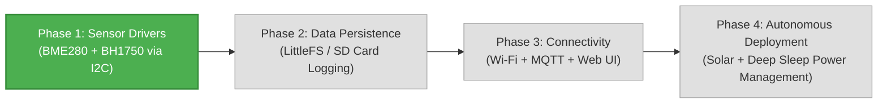
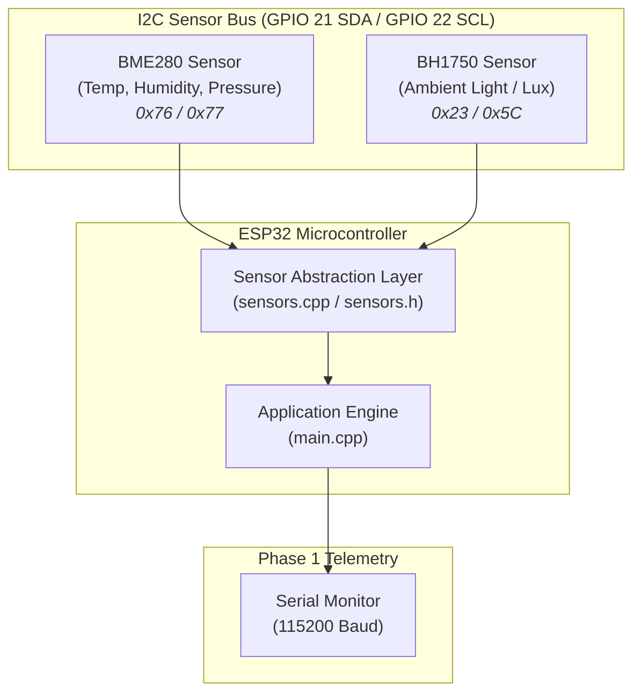

# ESP32 Autonomous Weather Station

<p align="center">
  
  
  
  
  
</p>

An embedded C++ environmental monitoring station powered by the **ESP32** microcontroller using the **PlatformIO** ecosystem. The system samples ambient atmospheric parameters using high-precision digital I2C sensors and outputs structured telemetry data.

---

## 📌 Project Status & Roadmap

**Current Status:** `Phase 1: Serial Sensor Reading` (Completed & Verified ✅)



- [x] **Phase 1: Serial Sensor Reading** — Modular I2C sensor driver abstraction (BME280 & BH1750) and serial telemetry output.
- [ ] **Phase 2: Data Persistence & Buffering** — Local logging (SPIFFS / LittleFS / SD card).
- [ ] **Phase 3: Connectivity & Dashboard** — Wi-Fi networking, REST API / MQTT, and embedded web UI.
- [ ] **Phase 4: Power Optimization** — Deep sleep management and solar autonomous operation.

---

## 🏗️ Architecture



---

## 🛠️ Hardware Requirements

| Component | Function | Interface | Default Address |
| :--- | :--- | :--- | :--- |
| **ESP32 Dev Module** | Main microcontroller (ESP-WROOM-32) | — | — |
| **BME280 Module** | Temperature, Relative Humidity, Barometric Pressure | I2C | `0x76` (or `0x77`) |
| **BH1750 Module** | Ambient Light / Luminosity (Lux) | I2C | `0x23` (or `0x5C`) |
| **Breadboard & Wires** | Prototyping connection | — | — |
| **Power Supply** | Micro-USB (5V) / Regulated 3.3V | — | — |

---

## 🔌 Wiring & Pinout Mapping

Both the BME280 and BH1750 communicate over the shared hardware **I2C bus** on the ESP32.

| ESP32 Pin | BME280 Pin | BH1750 Pin | Description |
| :--- | :--- | :--- | :--- |
| **3V3** | `VCC` / `VIN` | `VCC` | 3.3V Power Supply |
| **GND** | `GND` | `GND` | Common Ground |
| **GPIO 21** | `SDA` | `SDA` | I2C Serial Data line |
| **GPIO 22** | `SCL` | `SCL` | I2C Serial Clock line |

> [!NOTE]
> - Ensure your sensor breakout modules are powered with **3.3V** (do not apply 5V directly to sensor pins unless equipped with an onboard level shifter).
> - If your BME280 defaults to address `0x77`, the driver automatically probes and detects it without manual code edits.
> - Leave the `ADDR` pin on the BH1750 unconnected or tied to `GND` for address `0x23`.

---

## 📂 Project Structure

```text
Station-Meteo-ESP32/
├── include/
│   └── config.h          # Hardware pins, I2C addresses, and global constants
├── src/
│   ├── main.cpp          # Application lifecycle, RTOS scheduling, and telemetry output
│   ├── sensors.h         # Sensor data definitions and driver prototypes
│   └── sensors.cpp       # I2C driver implementations for BME280 and BH1750
├── platformio.ini        # PlatformIO configuration and library dependencies
├── .gitignore            # Git ignore rules for build artifacts and IDE files
├── LICENSE               # MIT Open Source License
└── README.md             # Project documentation
```

---

## 🚀 Getting Started

### Prerequisites

- [PlatformIO Core (CLI)](https://docs.platformio.org/page/core/index.html) or [VS Code PlatformIO Extension](https://marketplace.visualstudio.com/items?itemName=platformio.platformio-ide)
- Git

### Build and Upload

1. **Clone the repository:**
   ```bash
   git clone https://github.com/Ayoub81A/Station-Meteo-ESP32.git
   cd Station-Meteo-ESP32
   ```

2. **Compile the project:**
   ```bash
   pio run
   ```
   *(Or using the full PlatformIO path on Windows: `~/.platformio/penv/Scripts/platformio.exe run`)*

3. **Upload firmware to ESP32:**
   ```bash
   pio run --target upload
   ```

4. **Open the Serial Monitor (115200 baud):**
   ```bash
   pio device monitor
   ```

---

## 📊 Sample Serial Output

```text
**************************************************
*       ESP32 Autonomous Weather Station         *
*       Phase 1: Serial Sensor Reading           *
**************************************************
[SYSTEM] CPU Frequency: 240 MHz
[SYSTEM] Sampling interval: 2000 ms

[I2C] Initializing Wire bus...
[BME280] Probing sensor on 0x76
[BME280] OK (Detected on primary address 0x76)
[BH1750] Probing sensor on 0x23
[BH1750] OK (Detected on address 0x23)

[SYSTEM] All sensors initialized successfully. Starting telemetry stream...

==================================================
 [Weather Station Telemetry] Uptime: 2 s
==================================================
  Temperature : 22.45 °C
  Humidity    : 47.30 %
  Pressure    : 1013.85 hPa
  Luminosity  : 312.50 lx
==================================================
```

---

## 📄 License

This project is licensed under the MIT License - see the [LICENSE](LICENSE) file for details.
